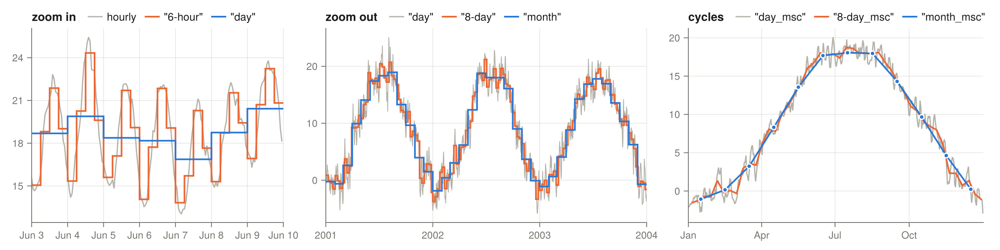

# TimeSamplers.jl



A Julia package for temporal sampling, aggregation, and resampling of N-dimensional arrays along their time dimension.

## Quick start

```julia
using TimeSamplers
using Dates

# Create a date vector
dates = collect(Date(2000, 1, 1):Day(1):Date(2000, 12, 31))

# Create time samplers for daily aggregation (returns a Vector{TimeSample})
daily_samplers = create_TimeSampler(dates, TimeDay())

# Example data (time is the first dimension, so size(data, 1) == length(dates))
data = rand(length(dates), 2)

# Apply sampling/aggregation (2-arg form defaults to `TimeNoDiff()`)
sampled_data = do_time_sampling(data, daily_samplers)
```

See the [API](api.md) page for the full list of methods.

## Resampling to n-unit periods

`time_resample` resamples data to any period given as a base unit and a count, in one
call. Supported units are second, minute, hour, day, week, month and year, with aliases
such as `s`, `sec`, `min`, `h`, `hr`, `d`, `w`, `mon`, `y` and `yr`. The single letter
`m` is not accepted because it could mean minute or month.

```julia
using TimeSamplers
using Dates

hourly = collect(DateTime(2000, 1, 1):Hour(1):DateTime(2001, 12, 31, 23))
data = rand(length(hourly), 2)

time_resample(data, hourly, "6-hour")                    # 6-hourly means
time_resample(data, hourly, Hour(6))                     # same, from a Dates.Period
time_resample(data, hourly, "3h")                        # "3-hour", "3hour" and "3 hour" also work
time_resample(data, hourly, :day; sampler_func=sum)      # daily sums
time_resample(data, hourly, "8-day"; origin=:year)       # 8-day bins restarting each Jan 1
time_resample(data, hourly, "3-hour_msc")                # seasonal cycle at 3-hour resolution
time_resample(data, hourly, "3-hour_msc_day")            # mean diurnal cycle, 8 values
time_resample(data, hourly, "8-day_iav")                 # 8-day values minus their seasonal cycle
time_resample(data, hourly, :mean)                       # mean over the whole record
time_resample_dates(hourly, "6-hour")                    # bin start dates of the output
```

The time dimension is the first by default and can be set with `dim`. Anomaly, MSC
anomaly and IAV targets subtract their reference automatically, so no `TimeDiff()` is
needed.

### Build once, apply many times

When many arrays share one time axis, such as the model realizations of an
optimization, build a `TimeResampler` once and reuse it. Applying it only allocates
the output.

```julia
rs = TimeResampler(hourly, "8-day_iav"; sampler_func=sum)
for realization in realizations
    iav = time_resample(realization, rs)
end
time_resample_dates(rs)                                  # dates of the output
```

`time_sampling_type(rs.method)` tells how the samplers are combined, and
`time_sampling_period("day_MSC")` gives the length of the bins, here one day.
Snake case names such as `"first_year"` or `"day_MSC"` resolve to the method types
`TimeFirstYear` and `TimeDayMSC`.

### Period specs

A period spec has the form `<n>-<unit>[_<kind>[_<cycle>]]`, where the separator may be
`_` or `-`. The count may also be joined to the unit, as in `"3h"`, and a bare unit
means a count of one.

| Spec | Method | Result |
|---|---|---|
| `"6-hour"` | `TimePeriodSample(Hour(6))` | 6-hour bins |
| `"8-day_anomaly"` | `TimePeriodAnomaly(Day(8))` | bin values minus the overall mean |
| `"8-day_msc"` | `TimePeriodMSC(Day(8))` | mean seasonal cycle of 8-day bins |
| `"3-hour_msc_day"` | `TimePeriodMSC(Hour(3), Day(1))` | mean diurnal cycle of 3-hour bins |
| `"8-day_msc_anomaly"` | `TimePeriodMSCAnomaly(Day(8))` | mean seasonal cycle minus the overall mean |
| `"month_iav"` | `TimePeriodIAV(Month(1))` | monthly values minus their seasonal cycle |
| `"mean"` | `TimeMean()` | mean over the whole record |

The same specs work with `create_TimeSampler` and `get_TimeSampler`. Names of existing
types such as `"TimeDayMSC"` resolve to those types as before.

### Bin alignment

- `origin=:calendar`, the default, floors dates on the calendar. Hour, minute and
  second bins align to midnight and month bins to Jan 1, so `"3-month"` gives calendar
  quarters. Bins of several days or weeks align to the `Dates` epoch rather than to the
  data.
- `origin=:start` counts bins from the first date.
- `origin=:year` restarts bins every Jan 1 and counts plain days, as MODIS 8-day
  products do, so the last bin of each year is short.

### Seasonal and diurnal cycles

MSC, MSC anomaly and IAV bins always restart at the start of each cycle. The cycle is
one year by default and can be set with a spec suffix such as `_day` or with the
`cycle` keyword. The MSC value at a position pools all timesteps at that position across
all cycles, and positions are returned in order of first appearance.

In a yearly cycle, days are matched by calendar date on a 366 day calendar. Mar 1 is
always averaged with Mar 1, Feb 29 only has values from leap years, and daily bins give
366 values when the record includes a leap year. Multi-day bins such as `"8-day_msc"`
have the same edges in every year, so the bin that holds Feb 29 is one day shorter in
other years.

## Available Time Sampling Methods

### Period methods

The period methods are the main API. Each takes any count of any unit, and the spec
string gives the same method.

| Method | Spec | Output |
|---|---|---|
| `TimePeriodSample(period; origin=:calendar)` | `"<n>-<unit>"` | one value per n-unit bin |
| `TimePeriodAnomaly(period; origin=:calendar)` | `"<n>-<unit>_anomaly"` | n-unit bins minus the mean of the record |
| `TimePeriodMSC(period, cycle=Year(1))` | `"<n>-<unit>_msc[_<cycle>]"` | mean seasonal or diurnal cycle of n-unit bins |
| `TimePeriodMSCAnomaly(period, cycle=Year(1))` | `"<n>-<unit>_msc_anomaly[_<cycle>]"` | mean cycle minus the mean of the record |
| `TimePeriodIAV(period, cycle=Year(1))` | `"<n>-<unit>_iav[_<cycle>]"` | n-unit bins minus their mean cycle |
| `TimeMean()` | `"mean"` | one mean over the whole record |

### Calendar methods

The calendar methods are legacy aliases kept for backward compatibility. Each one is
the period method in the same row, and gives the same samplers, values and labels,
including for `skip_sampling`. They resolve from their snake case names, which
existing configurations use. New code should use the period methods.

| Calendar method | Name | Period method | Spec |
|---|---|---|---|
| `TimeHour()` | `"hour"` | `TimePeriodSample(Hour(1))` | `"1-hour"` |
| `TimeDay()` | `"day"` | `TimePeriodSample(Day(1))` | `"1-day"` |
| `TimeMonth()` | `"month"` | `TimePeriodSample(Month(1))` | `"1-month"` |
| `TimeYear()` | `"year"` | `TimePeriodSample(Year(1))` | `"1-year"` |
| `TimeHourAnomaly()` | `"hour_anomaly"` | `TimePeriodAnomaly(Hour(1))` | `"1-hour_anomaly"` |
| `TimeDayAnomaly()` | `"day_anomaly"` | `TimePeriodAnomaly(Day(1))` | `"1-day_anomaly"` |
| `TimeMonthAnomaly()` | `"month_anomaly"` | `TimePeriodAnomaly(Month(1))` | `"1-month_anomaly"` |
| `TimeYearAnomaly()` | `"year_anomaly"` | `TimePeriodAnomaly(Year(1))` | `"1-year_anomaly"` |
| `TimeHourDayMean()` | `"hour_day_mean"` | `TimePeriodMSC(Hour(1), Day(1))` | `"1-hour_msc_day"` |
| `TimeDayMSC()` | `"day_MSC"` | `TimePeriodMSC(Day(1))` | `"1-day_msc"` |
| `TimeMonthMSC()` | `"month_MSC"` | `TimePeriodMSC(Month(1))` | `"1-month_msc"` |
| `TimeDayMSCAnomaly()` | `"day_MSC_anomaly"` | `TimePeriodMSCAnomaly(Day(1))` | `"1-day_msc_anomaly"` |
| `TimeMonthMSCAnomaly()` | `"month_MSC_anomaly"` | `TimePeriodMSCAnomaly(Month(1))` | `"1-month_msc_anomaly"` |
| `TimeDayIAV()` | `"day_IAV"` | `TimePeriodIAV(Day(1))` | `"1-day_iav"` |
| `TimeMonthIAV()` | `"month_IAV"` | `TimePeriodIAV(Month(1))` | `"1-month_iav"` |

`examples/calendar_vs_nstep.jl` checks every row of this table and plots the outputs
of both methods.

### Time selection

The selection methods pick time steps instead of resampling them, so they have no
period equivalent and are not accepted by `TimeResampler`. Apply them with
`do_time_sampling(dat, samplers, TimeIndexed())`, which selects along the first
dimension.

| Method | Name | Selects |
|---|---|---|
| `TimeAllYears()` | `"all_years"` | every time step |
| `TimeFirstYear()` | `"first_year"` | the time steps of the first year |
| `TimeRandomYear()` | `"random_year"` | the time steps of one random year |
| `TimeShuffleYears()` | `"shuffle_years"` | whole years in a random order |

## Usage Examples

### Basic Temporal Aggregation

```julia
using TimeSamplers
using Dates

# Create date vector
dates = collect(Date(2000, 1, 1):Day(1):Date(2000, 12, 31))

# Create samplers for different time scales
daily_sampler = create_TimeSampler(dates, TimeDay())
monthly_sampler = create_TimeSampler(dates, TimeMonth())
yearly_sampler = create_TimeSampler(dates, TimeYear())
```

### Anomaly Calculations

```julia
using TimeSamplers
using Dates

# Create dates for multiple years
dates = collect(Date(2000, 1, 1):Day(1):Date(2002, 12, 31))

# Calculate daily anomalies
daily_anomaly_sampler = create_TimeSampler(dates, TimeDayAnomaly())

# Calculate monthly anomalies
monthly_anomaly_sampler = create_TimeSampler(dates, TimeMonthAnomaly())

# Calculate MSC (Multi-year Seasonal Cycle) anomalies
msc_anomaly_sampler = create_TimeSampler(dates, TimeDayMSCAnomaly())
```

### Climatological Statistics

```julia
using TimeSamplers
using Dates

# Create dates spanning multiple years
dates = collect(Date(2000, 1, 1):Day(1):Date(2010, 12, 31))

# Calculate Multi-year Seasonal Cycle (MSC)
msc_sampler = create_TimeSampler(dates, TimeDayMSC())

# Calculate Inter-Annual Variability (IAV)
iav_sampler = create_TimeSampler(dates, TimeDayIAV())
```

## Integration with Other Packages

TimeSamplers.jl is designed to work seamlessly with other packages in the SINDBAD ecosystem:

- **ErrorMetrics.jl**: Temporal aggregation is often used before calculating metrics
- **Sindbad**: Used in cost options for temporal data aggregation during parameter optimization

Example integration in SINDBAD:

```julia
using TimeSamplers
using ErrorMetrics
using Sindbad

# Define cost options with temporal aggregation
cost_options = (
    variable = :gpp,
    cost_metric = MSE(),
    temporal_data_aggr = TimeDay(),  # From TimeSamplers.jl
    # ... other options
)
```

## Best Practices

1. **Date Alignment**: Ensure your date vector matches the time dimension of your data
   and is sorted in ascending order, since bins are formed from contiguous dates
2. **Multiple Years**: For anomaly and climatological calculations, use date vectors spanning multiple years
3. **Performance**: TimeSamplers uses efficient array views to avoid unnecessary data copying
4. **Consistency**: Use the same time sampler for both model output and observations when comparing

## Adding New Time Sampling Methods

To add a new time sampling method:

1. Define a new type that subtypes `TimeSamplerMethod`
2. Implement `create_TimeSampler` for it
3. Add appropriate documentation and a `purpose` function

A new period based method subtypes `TimePeriodMethod` and can reuse the internal helpers
in `src/resampleTimeSampler.jl` that build bin and cycle keys.

See the package source code for examples of existing implementations.
